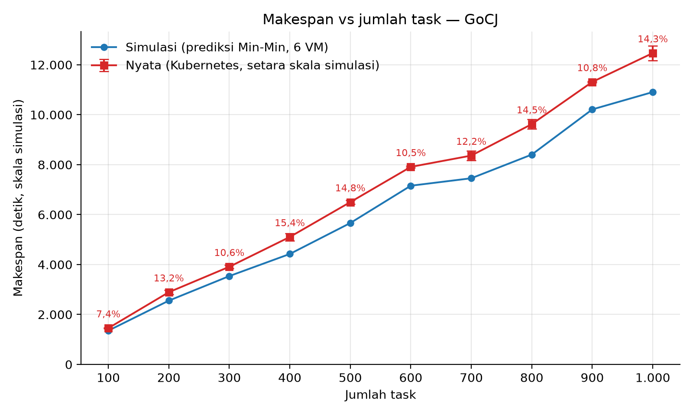
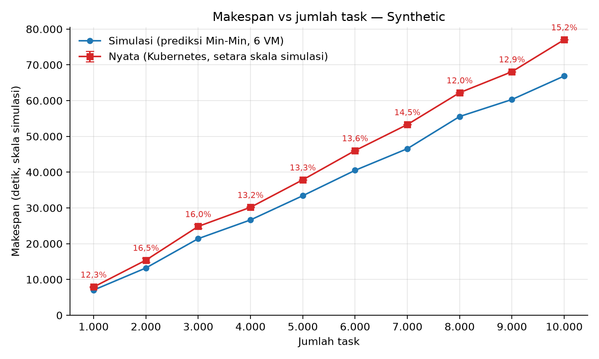
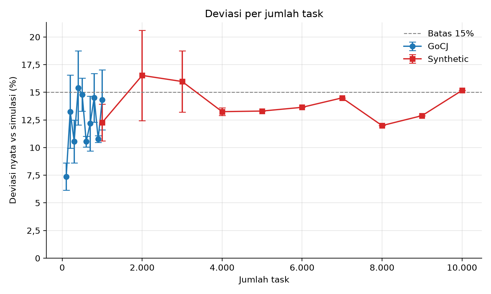

# Penjadwalan Min-Min pada Kubernetes: Perbandingan Simulasi dan Implementasi Nyata

Kelompok / anggota: *(isi)*

## 1. Ringkasan

Proyek ini membandingkan prediksi makespan algoritma Min-Min pada simulasi (CloudSim) dengan hasil eksekusi nyata pada Kubernetes (kind) di satu laptop.

- **Dataset:** GoCJ (100–1.000 task) dan Synthetic (1.000–10.000 task).
- **Topologi:** 1 datacenter, 2 host, 3 VM per host (1.000, 2.000, 3.000 MIPS).
- **Hasil:** makespan nyata lebih lambat 7–17% dari prediksi simulasi; 16 dari 20 dataset berada di bawah atau sama dengan 15%. Utilisasi VM nyata 76–98%.
- **Kesimpulan:** pola makespan nyata sejajar dengan simulasi, sehingga implementasi Min-Min pada lingkungan nyata sesuai dengan prediksi.

## 2. Arsitektur dan Metode

| CloudSim | Implementasi nyata |
|---|---|
| Datacenter | Cluster kind (Docker Desktop) |
| Host (2) | Node worker `soka-worker` (host-1), `soka-worker2` (host-2) |
| VM (6) | Pod `vm-0` s.d. `vm-5`; batas CPU 250m / 500m / 750m untuk 1.000 / 2.000 / 3.000 MIPS |
| Cloudlet | Permintaan HTTP berisi panjang task (MI) |
| Penjadwal Min-Min | `real/controller.py` (port 1:1 dari `MinMinScheduler.java`) |

```
Cluster kind "soka"
 |-- control-plane : soka-controller (penjadwal Min-Min dan pengirim task)
 |-- soka-worker   : vm-0 (1.000)  vm-1 (2.000)  vm-2 (3.000)  [MIPS]
 `-- soka-worker2  : vm-3 (1.000)  vm-4 (2.000)  vm-5 (3.000)  [MIPS]
```

**Alur satu percobaan:**
1. Controller membaca dataset dan menghitung jadwal Min-Min serta prediksi makespan.
2. Task dikirim ke VM melalui HTTP sesuai urutan jadwal; setiap VM memproses satu task pada satu waktu (FIFO).
3. VM menjalankan loop komputasi yang durasinya sebanding dengan MI / MIPS.
4. Controller mencatat waktu mulai dan selesai, lalu menghitung makespan, utilisasi, waiting time, dan throughput.

**Skala waktu:** 0,05 (waktu simulasi diperkecil 20 kali). Makespan nyata dikonversi kembali ke skala simulasi sebelum dibandingkan.

**Deviasi** = (makespan nyata − prediksi simulasi) / prediksi simulasi × 100%.

## 3. Dataset

| Dataset | Ukuran | Keterangan |
|---|---|---|
| GoCJ | 100–1.000 task (kelipatan 100) | Hussain & Aleem (2018); panjang task 15.000–900.000 MI |
| Synthetic | 1.000–10.000 task (kelipatan 1.000) | 60% kecil, 30% sedang, 10% besar (10.000–500.000 MI) |

## 4. Hasil

Setiap dataset dijalankan 3 kali dan dirata-rata, kecuali Synthetic 5.000–10.000 (1 kali).

### 4.1 Makespan: simulasi vs nyata





### 4.2 Deviasi



### 4.3 Tabel deviasi (rata-rata)

| GoCJ (task) | 100 | 200 | 300 | 400 | 500 | 600 | 700 | 800 | 900 | 1.000 |
|---|---|---|---|---|---|---|---|---|---|---|
| Ulangan | 3 | 3 | 3 | 3 | 3 | 3 | 3 | 3 | 3 | 3 |
| Deviasi (%) | 7,4 | 13,2 | 10,6 | 15,4 | 14,8 | 10,5 | 12,2 | 14,5 | 10,8 | 14,3 |

| Synthetic (task) | 1.000 | 2.000 | 3.000 | 4.000 | 5.000 | 6.000 | 7.000 | 8.000 | 9.000 | 10.000 |
|---|---|---|---|---|---|---|---|---|---|---|
| Ulangan | 3 | 3 | 3 | 3 | 1 | 1 | 1 | 1 | 1 | 1 |
| Deviasi (%) | 12,3 | 16,5 | 16,0 | 13,2 | 13,3 | 13,6 | 14,5 | 12,0 | 12,9 | 15,2 |

Tabel lengkap (prediksi, makespan nyata, utilisasi, waiting time, throughput): `results_real/ringkasan_deviasi.md` dan `.csv`.

### 4.4 Analisis

- Makespan nyata dan simulasi naik sejajar terhadap jumlah task; makespan nyata konsisten sedikit lebih tinggi.
- Selisih diduga berasal dari overhead lingkungan nyata (komunikasi HTTP, pembatasan CPU, satu mesin dipakai bersama); belum diukur terpisah.
- Empat dataset melampaui ambang 15% (GoCJ-400 15,4%; Synthetic-2.000 16,5%; Synthetic-3.000 16,0%; Synthetic-10.000 15,2%).

Grafik detail per dataset (beban VM, urutan vs panjang task, waiting time, Gantt) tersedia di `results_real/grafik/` (`grafik_4_*` s.d. `grafik_7_*`).

## 5. Validasi

- **Kesamaan dengan Java:** `real/crosscheck.py` menunjukkan penempatan VM dan urutan jadwal identik 100% dengan CloudSim pada GoCJ-100, 300, 500, 1.000 dan Synthetic-1.000 (selisih makespan maksimum 0,11 detik).
  ```powershell
  python real/crosscheck.py data/GoCJ_Dataset_300.txt results_sim/gocj300_6vm.csv
  ```
- **Validasi otomatis per percobaan** (`real/demo_report.py`): semua task sukses, VM dan urutan sesuai rencana, tidak ada tumpang tindih, task tersebar di 2 host, makespan di atas batas bawah teoritis, deviasi dalam batas.

## 6. Struktur Repositori

| Path | Isi |
|---|---|
| `data/` | Dataset GoCJ dan Synthetic |
| `k8s/` | Manifest Kubernetes |
| `real/` | Kode percobaan nyata (setup, controller, worker, batch, grafik, validasi) |
| `results_sim/` | Hasil CloudSim untuk 5 dataset (GoCJ-100, 300, 500, 1.000, Synthetic-1.000) |
| `results_real/` | Hasil nyata per run, grafik, dan ringkasan |

## 7. Cara Menjalankan

**Prasyarat:** Docker Desktop (aktif), kind, kubectl, Python 3 dengan `numpy` dan `matplotlib`. Jalankan dari root repositori di PowerShell. Bila skrip diblokir: `Set-ExecutionPolicy -Scope Process -ExecutionPolicy Bypass`.

```powershell
.\real\setup_cluster.ps1      # buat cluster (sekali)
.\real\deploy_vms.ps1         # buat 6 VM
.\real\run_experiment.ps1 -Dataset data/GoCJ_Dataset_100.txt -Algo minmin -Out results_real/gocj100_minmin_run1
```

**Batch** (folder hasil yang sudah ada dilewati):

```powershell
.\real\batch_gocj.ps1
.\real\batch_synthetic.ps1 -Sizes 1000,2000 -Runs 3
```

**Grafik dan ringkasan** (urutan harus seperti ini):

```powershell
foreach ($d in "gocj100","gocj1000","syn1000","syn10000") { python real/analisis_lengkap.py results_real $d }
python real/grafik_makespan.py
```

## 8. Prosedur Demonstrasi

**Persiapan:** Docker Desktop aktif; `kubectl get nodes` menampilkan 3 node dan `kubectl get pods -o wide` menampilkan 6 pod `vm-*` berstatus `Running`. Jika tidak, jalankan ulang `setup_cluster.ps1` dan `deploy_vms.ps1`.

```powershell
kubectl get nodes
kubectl get pods -o wide
.\real\run_experiment.ps1 -Dataset data/GoCJ_Dataset_100.txt -Algo minmin -Out results_real/demo
python real/demo_report.py data/GoCJ_Dataset_100.txt results_real/demo
```

Folder `results_real/demo` tidak memengaruhi grafik utama. Untuk menampilkan seluruh task pada tabel: `--rows 100`.

**Cadangan** (tanpa cluster, memakai hasil yang sudah ada):

```powershell
python real/demo_report.py data/GoCJ_Dataset_100.txt results_real/gocj100_minmin_run1
python real/demo_report.py data/Synthetic_1000.txt results_real/syn1000_minmin_run1
```

Untuk run Synthetic dengan deviasi di atas 20%, tambahkan `--tol 25`.

## 9. Keterbatasan

- Pod Kubernetes meniru VM; kecepatan diatur melalui batas CPU, bukan perangkat keras berbeda.
- Kedua host berada pada satu laptop sehingga berbagi sumber daya.
- Nilai MIPS merupakan kuota CPU hasil kalibrasi (`real/calibrate.py`), bukan MIPS fisik.
- Skala waktu 0,05; task di bawah sekitar 0,3 detik nyata rawan jitter.
- Synthetic 5.000–10.000 hanya 1 ulangan sehingga tanpa simpangan baku.
- Garis simulasi pada grafik dihitung dari port Python Min-Min (`results_real/prediksi_6vm.json`) yang telah dibuktikan identik dengan CloudSim pada 5 dataset.
- Percobaan awal dengan satu pod per task (Azure) tidak dipakai karena waktu start pod mendominasi durasi task.
- Ambang 15% merupakan target internal kelompok.

## 10. Referensi

- Hussain, A., & Aleem, M. (2018). GoCJ: Google Cloud Jobs Dataset for Distributed and Cloud Computing Infrastructures. *Data*, 3(4), 38. https://doi.org/10.3390/data3040038
- Calheiros, R. N., et al. (2011). CloudSim: a toolkit for modeling and simulation of cloud computing environments. *Software: Practice and Experience*, 41(1), 23–50.
- kind: https://kind.sigs.k8s.io
